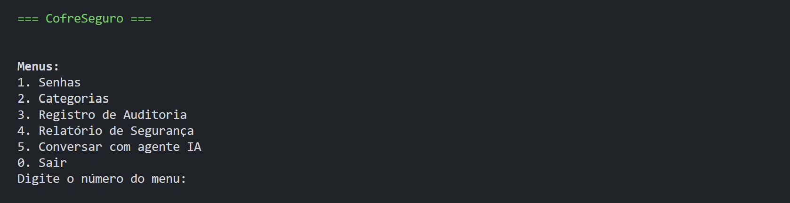
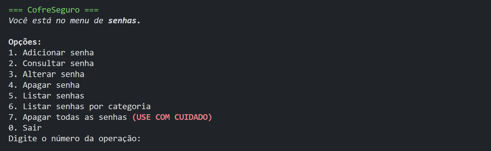
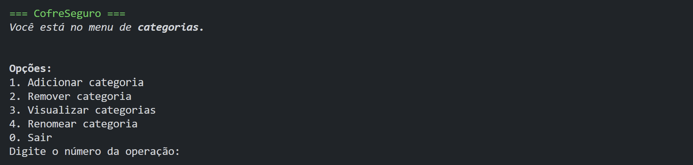
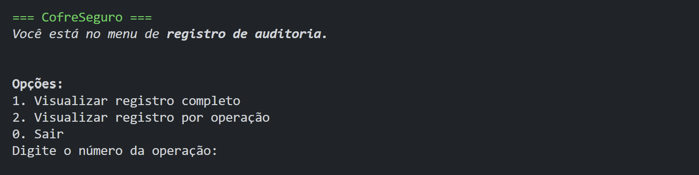
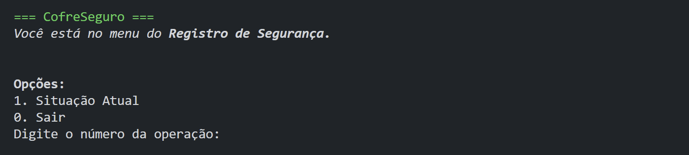
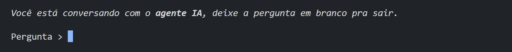

# COFRESEGURO-g2

O projeto  **Cofre Seguro**  é um sistema focado em um gerenciador de serviços, no qual busca _registrar, guardar e criar senhas e categorias_ para que o usuário mantenha seus dados a salvo.

> 
> ####  O grupo é composto pelos membros:
> * ANDRESSA GABRIELLE BASTOS ALVES
> * DANILO QUEIROZ DE BARROS
> * MARIANA NUNES BARBOSA PEIXOTO
> * MATHEUS ALEXANDRE MUCARBEL DE CARVALHO
> * TARCIZO PEREIRA DA SILVA NETO
> * RENNAN LUIZ DO AMARAL PINTO

---

###  **Funcionamento do Cofre :** 
> O nosso sistema foi organizado em um grupo de menus, capazes de gerenciar as funções cruciais para torná-lo completo e funcional, sendo elas:
> * Um menu de senhas;
> * Um menu de categorias;
> * Um registro de auditoria;
> * Um relatório de segurança.

Imagem do menu principal:

---

###  **Menu de senhas :** 

O menu de senhas foi criado para que o usuário pudesse ter um  **controle maior**  de seus registros. Nele, existem algumas funções possívels de serem feitas. É possível:
> * Adicionar uma nova senha, atribuída a um serviço específico;
> * Consultar uma senha desejada;
> * Alterar uma senha já existente de um serviço específico;
> * Listar as senhas, sejam de modo geral ou por categoria;
> * Apagar **todas** as senhas.

 **OBSERVAÇÃO :**  A opção de apagar todas as senhas possui um aviso de "cuidado ao selecionar", pois uma vez apagadas, não é possível retorná-las ao registro do usuário.

Imagem do menu de senhas: 

--- 
###  **Menu de categorias :** 

O menu de categorias é mais refinado, contendo menos funções, mas sendo essas existentes as primordiais para um bom menu. Dentre as funções existentes, o usuário pode:
> * Adicionar uma nova categoria, referente à área que o serviço escolhido faz parte. Ex: Streaming, Saúde, etc;
> * Remover uma categoria já existente no sistema;
> * Visualizar todas as categorias registradas;
> * Renomear uma categoria.

Imagem do menu de categorias: 

---
###  **Registro de auditoria :** 

O registro de auditoria serve para 
 armazenar o tempo e qualquer ocorrência que venha de uma operação feita pelo usuário. O usuário, ao abrir o menu do registro de auditoria pode:

> * Visualizar o registro completo, no qual apresenta as ações feitas até o tempo atual, sem especificar a categoria;
> * Visualizar o registro por categoria.

Imagem do registro de auditoria: 

---
###  **Relatório de segurança :** 

O relatório ou registro de segurança tem como função resumir a situação atual do sistema de serviços, contabilizando a quantidade de senhas registradas e de credenciais registradas. Com o relatório de segurança, o usuário pode:

> * Checar o cenário atual, com a quantidade de senhas e credenciais registradas;
> * Checar a quanto tempo uma certa senha não foi alterada.

Imagem do relatório de segurança: 

---
###  **Interação com a IA :** 

A IA implementada no sistema possui a **função de auxiliar o usuário em suas dúvidas gerais**, respondendo-o de acordo com o que for perguntado em relação ao cofre. Ao selecionar a opção de "conversar com a IA", o usuário confirma o uso dos dados e segue com a pergunta. Com isso, a IA analisa e responde. 

 **OBSERVAÇÃO :**  a IA possui certas restrições que garantem a segurança do usuário, não correspondendo a pedidos que infrinjam a privacidade dos demais registros.

Imagens da interação com IA: 

